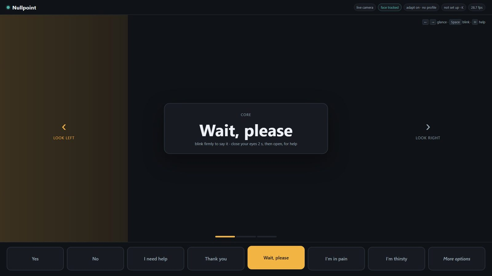
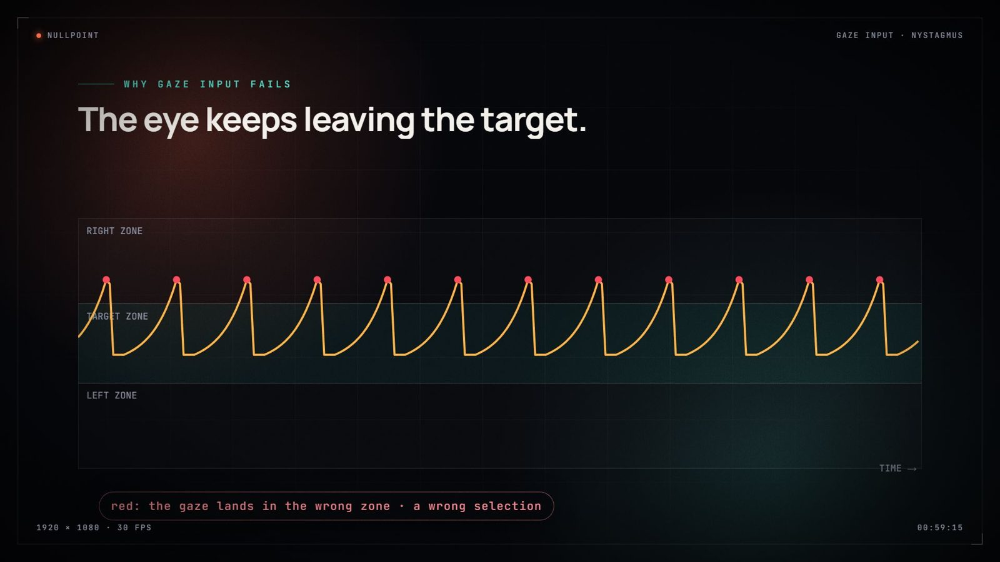
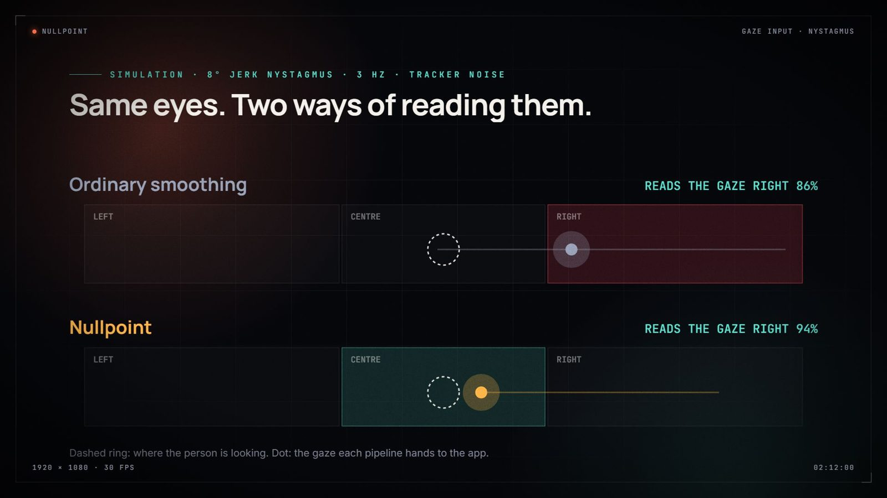
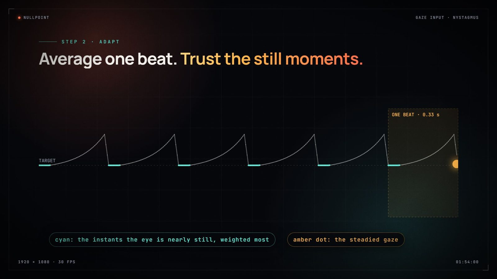
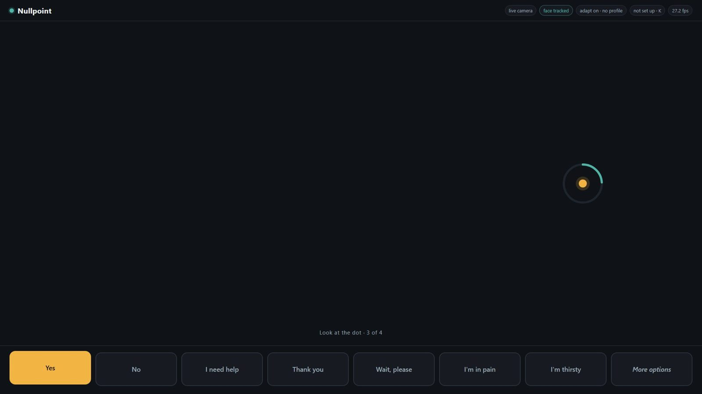
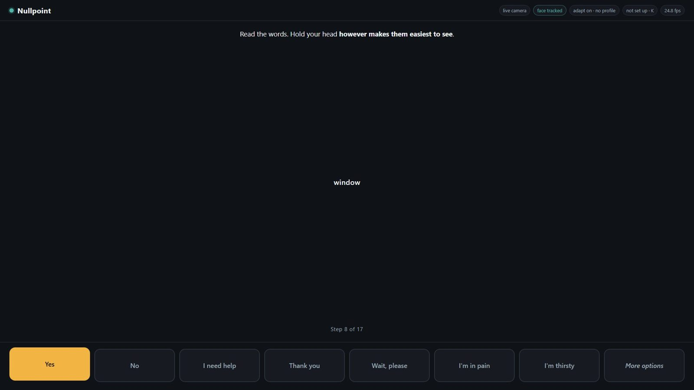

# Nullpoint

**Eye tracking for eyes that won't hold still.**

**▶ [Watch the demo video](https://youtu.be/tpE-M9nMaTg)**



## The problem

About **1 in 400 people have nystagmus**: their eyes drift and flick back several times a second, without their control. Some are born with it; others develop it after a stroke, MS or a brain injury, often the same people who rely on their eyes to communicate.

Eye tracking is becoming a normal way to control devices (Vision Pro, iPhone and iPad Eye Tracking, Google's Look to Speak, eye-gaze communication boards). All of them assume steady eyes. With nystagmus the gaze keeps sliding out of the target, so the system selects the wrong thing, and the official advice is to give up on the eyes and use the head instead.



## What Nullpoint does

Nullpoint measures how a person's eyes move, then adapts gaze input to that rhythm instead of fighting it.

1. **Measure.** In 40 seconds with a webcam: where the eyes are calmest (the null zone). With phone slow-motion video: the full profile (frequency, amplitude, fast-phase direction, waveform).
2. **Adapt.** Average the gaze over exactly one beat of the nystagmus, weighting the instants when the eye is nearly still. Selections are timed in whole beats, and the most important targets sit in the null zone.
3. **Use.** Any gaze app can sit on top. Nullpoint ships with an offline communication board: look left or right to move, blink firmly to speak, close the eyes for two seconds and open them to call for help on a caregiver's phone.

| | |
|---|---|
|  |  |
| Same eyes: ordinary smoothing slips into the wrong zone, Nullpoint holds. | The filter: one beat, still moments weighted most. |
|  |  |
| 10-second setup: a new user's model is learned on the spot. | Null-zone finder: where the eyes settle while reading. |

**Result.** In a replay benchmark on recorded eye movements with 15° of nystagmus added, the board moved correctly on **6 of 12** left/right glances without adaptation and **12 of 12** with Nullpoint, at about 0.2 s more delay (small test: one person's recordings, simulated nystagmus). Every number comes from a script in [`eval/`](eval).

## Run it (Windows 10/11)

**One click:** download [`setup.bat`](setup.bat) and double-click it. It installs Git and Python 3.12 if needed, downloads Nullpoint, installs everything and opens it in your browser. Afterwards, start it with `run.bat` (`run.bat --sim` without a webcam).

**Manual setup:**
```bash
git clone https://github.com/Crriminson/nullpoint.git && cd nullpoint
py -3.12 -m venv .venv && .venv\Scripts\activate
pip install -r requirements.txt && pip install -e .
python -m nullpoint            # webcam board; add --sim for keyboard only, --lan for the caregiver phone view
```
Optional, for the slow-motion analysis: `pip install torch==2.15.0 --index-url https://download.pytorch.org/whl/cpu`.

**Using it:** follow the four dots of the 10-second setup, then look left or right to move and blink firmly to speak. Press **H** for help, **N** to find your null zone, **S** to add simulated nystagmus and **A** to switch adaptation on and off.

## How it is built

| Part | Method | Code |
|---|---|---|
| Face and eye landmarks | MediaPipe Face Landmarker, 478 landmarks, ~5 ms/frame on CPU | `nullpoint/capture.py`, `features.py` |
| Where you look | LDA on eye-in-head features + sticky HMM; fitted from the 10-second setup, self-correcting during use | `nullpoint/models/glance.py`, `board/selector.py` |
| Deliberate blinks | event detector; duration rule, LightGBM or GRU | `nullpoint/models/blink.py` |
| Nystagmus measurement | NCC iris tracking in slow-mo, autocorrelation metrics, 1D-CNN waveform classifier, Gaussian-process null point | `nullpoint/scope/` |
| Webcam null zone | eye-in-head angle while reading, head-turn cross-check, bootstrap CI | `nullpoint/adapt/nullzone.py` |
| Adaptation | foveation-weighted average over one nystagmus period | `nullpoint/adapt/` |
| Board | FastAPI + WebSocket, offline HTML, Windows speech | `nullpoint/board/` |

Use the adaptation in your own gaze app:
```python
from nullpoint.adapt import GazeStabilizer
stab = GazeStabilizer.from_profile()
x_steady = stab(raw_gaze_x)          # any tracker, any unit
```

`pytest` runs the tests.

## Principles

* **Offline and private.** No cloud. Face video never leaves the laptop; only landmarks are stored, in a git-ignored folder.
* **Measured, not claimed.** Each learned model is compared with the simple rule it replaces.
* **Honest scope.** Tested on one person with mild nystagmus, plus simulated nystagmus. Not a medical device.

## Licences

MediaPipe and OpenCV (Apache 2.0), scikit-learn (BSD), LightGBM (MIT), PyTorch (BSD), FastAPI (MIT), pyttsx3 (MPL 2.0). Methods and sources are credited in [`docs/RESOURCES.md`](docs/RESOURCES.md).
